# ITU-CS-464-LAB-07-BSSE23013

**CS464 Game Development, Lab 07 (UI/UX)**
Muhammad Sarmad Ahmad, BSSE23013

ROLL RUSH is a small mobile ball game. For this lab I only built its menu system: ten connected screens in **one scene and one Canvas**. The actual level is not part of the lab, so the Game screen is a stand-in with a Pause button and two buttons that end the level (win or fail). The inpspiration was taken from "Smash Hit" thst is used to play for time pass or as in achiever in past.

- **Demo video:** https://drive.google.com/file/d/1nSqOYAJ2srfknmyWP-u9usq9yGPwufjx/view?usp=sharing

## How to run

1. Clone the repo and open the folder in Unity Hub with Unity **6000.3.24f1**.
2. Open `Assets/Scenes/MenuSystem.unity`.
3. In the Game view choose a portrait ratio (Phone 9:16) and press Play. The mouse acts as touch.

A ready-to-run Windows build (`.exe`) is in the `Build/` folder (Link to Build Folder ([Drive Link to Folder](https://drive.google.com/file/d/1_CjPwVbqG6IqGiiQMPe-RovQivwPY8FG/view?usp=sharing))). It opens as a portrait window that keeps its ratio.

## Design choices used on every screen

- **Colours (60-30-10):** deep indigo background (#0F1230 / #1A1F52) for about 60%, lighter indigo panels and secondary buttons (#252B6B / #343C94) for about 30%, and orange (#FF8A1F) for about 10%, only on the main action of a screen. Green and gold are used for rewards, red for danger or failure.
- **Text:** TextMeshPro. Lilita One for titles and Poppins for everything else. Light text on the dark background has very high contrast, and dark text on orange is about 7.8:1 (WCAG AA needs 4.5:1).
- **Touch targets:** every button is at least 120 px tall on the 1080 x 1920 reference screen (about 44 pt).
- **Scaling:** Canvas Scaler is *Scale With Screen Size* (1080 x 1920, match 0.5) and elements are anchored, so it keeps its shape on different phones.

## The ten screens

The numbers in each list match the numbered pink circles on the colour screenshot.

### 1. Title

**Purpose:** First screen. Shows the game name and asks the player to tap.

**Principles:** Hierarchy: the logo is the biggest thing and the only orange accent. One call to action (the whole screen is the touch target).

**Tweens / ease:** The pulsing text is a sine-wave scale; the screen itself slides in.

| Colour (annotated) | Greyscale |
|---|---|
| 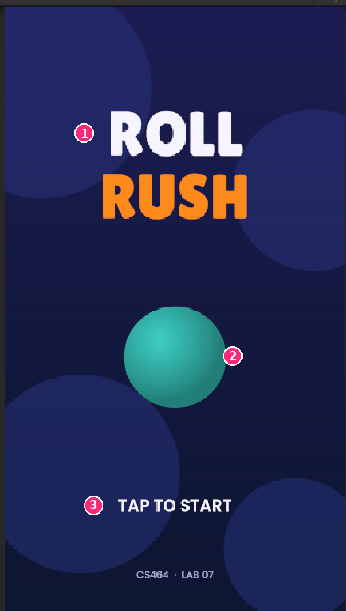 | 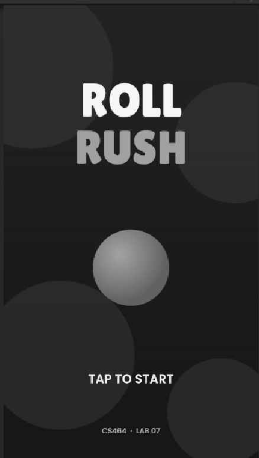 |

1. Logo: biggest element, white and orange.
2. Ball: a simple visual that says what the game is about.
3. TAP TO START pulses so the player knows what to do.

**Greyscale check:** Logo and prompt keep the same contrast in grey, so nothing needed changing.

### 2. Main Menu

**Purpose:** The hub that leads to everything else.

**Principles:** Ranking by size and colour: PLAY > SHOP > Settings/Credits. The coin count sits in the corner where players expect it.

**Tweens / ease:** Slides in from the right with the ease-in-out curve (`slideCurve`) while fading in.

| Colour (annotated) | Greyscale |
|---|---|
| 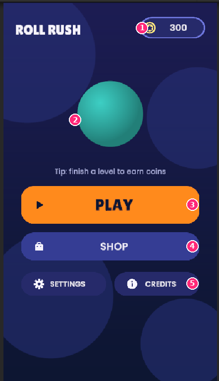 | 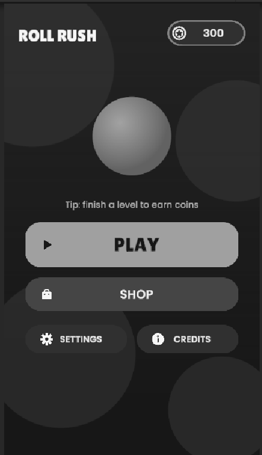 |

1. Coin counter in the top corner, always visible.
2. Ball preview and a short tip line (Settings can hide the tip).
3. PLAY: biggest, the only orange button.
4. SHOP: wide but blue, so it clearly comes second.
5. Settings and Credits are small because they are used rarely.

**Greyscale check:** PLAY is still the lightest button in grey, SHOP is mid-grey and the bottom row is darkest, so the order of importance survives without colour.

### 3. Levels

**Purpose:** Pick a level to play.

**Principles:** Repetition: every level is the same row. State is shown by more than colour: locked levels get a lock icon and the word LOCKED.

**Tweens / ease:** Slides in from the right with the ease-in-out curve (`slideCurve`) while fading in.

| Colour (annotated) | Greyscale |
|---|---|
| 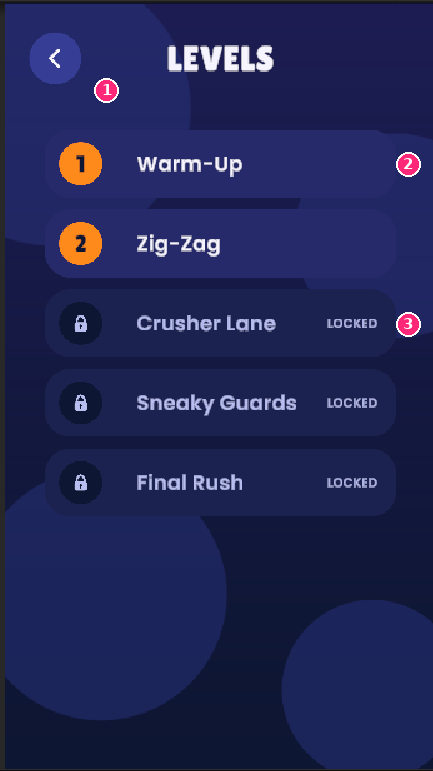 | 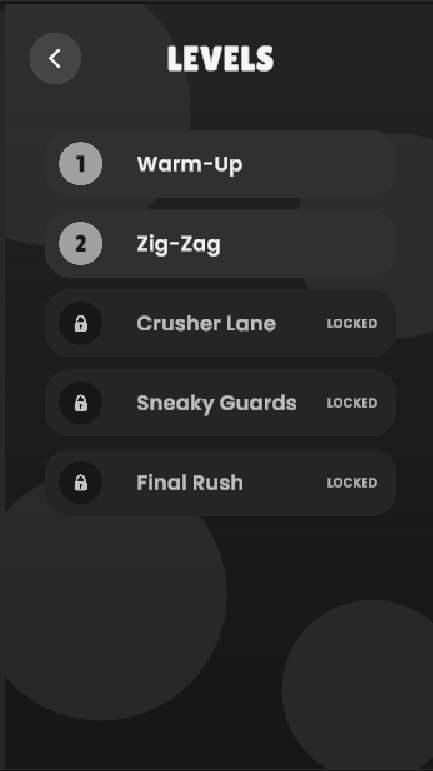 |

1. Back button, same place on every screen.
2. Unlocked level: bright number badge and a lighter row.
3. Locked level: dark row, lock icon and the word LOCKED.

**Greyscale check:** Locked rows were too close to the open ones, so I added the lock icon and the LOCKED label. In grey the badges and rows now clearly differ.

### 4. Loadout

**Purpose:** Choose a ball skin before starting.

**Principles:** Live preview (the player sees the result big). The selected skin is shown by a frame, not only by colour. START is the only orange button.

**Tweens / ease:** Slides in from the right with the ease-in-out curve (`slideCurve`) while fading in.

| Colour (annotated) | Greyscale |
|---|---|
| 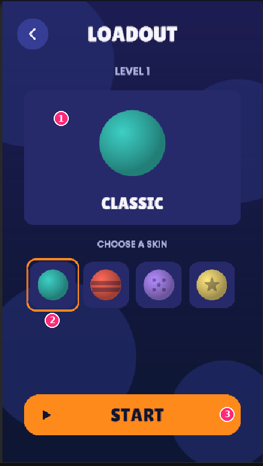 | 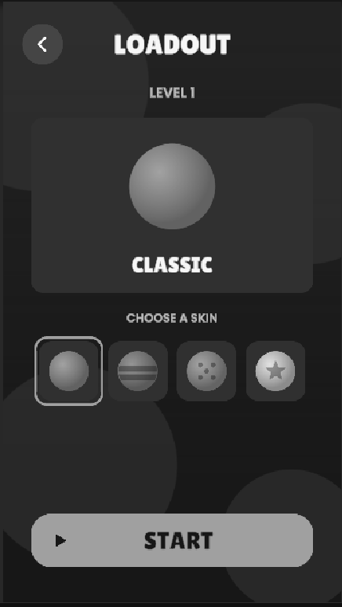 |

1. Large preview with the skin name below it.
2. Selected skin has a bright frame around it.
3. START: the main action, at the bottom where the thumb is.

**Greyscale check:** The teal and gold skins turned into almost the same grey, so the four skins have different patterns (plain, stripes, dots, star) and the name is written under the preview.

### 5. Game (stand-in)

**Purpose:** Placeholder for the real level. It lets me test the full flow.

**Principles:** Thumb-zone layout: buttons at the bottom. FINISH LEVEL is orange, FAIL LEVEL is blue, so there is a clear main choice.

**Tweens / ease:** Pops in (grows from 85% with a small overshoot, `popCurve`) because it opens on top of the game instead of beside it.

| Colour (annotated) | Greyscale |
|---|---|
| 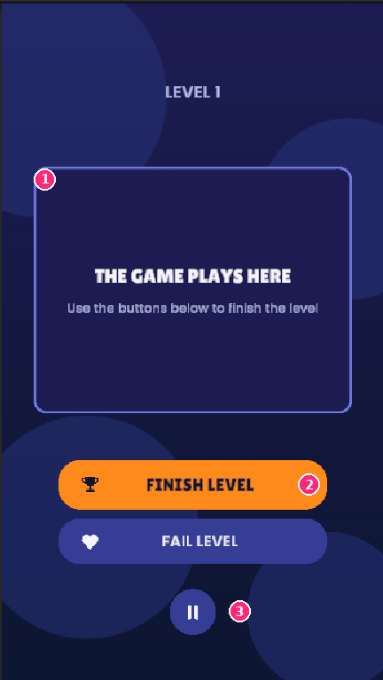 | 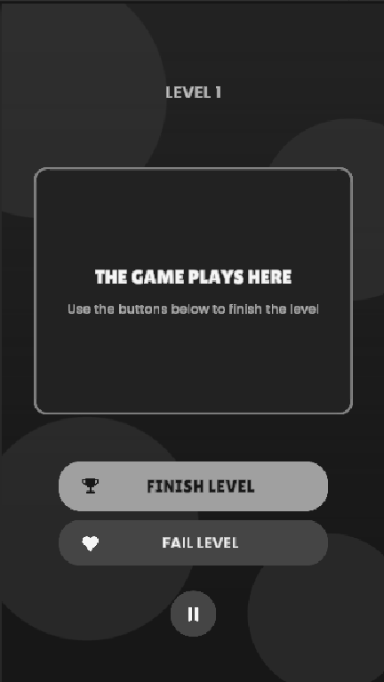 |

1. Area where the level would run.
2. FINISH LEVEL ends the level as a win (FAIL LEVEL, below it, ends it as a loss).
3. Pause button opens the Pause screen.

**Greyscale check:** FINISH (light grey) and FAIL (darker grey) are different, and both have an icon and words.

### 6. Pause

**Purpose:** Stops the game without leaving it.

**Principles:** Dimmed background keeps the game visible behind it. Resume is orange and Quit is red with an icon and words, and they are far apart so they are not pressed by mistake.

**Tweens / ease:** Pops in (grows from 85% with a small overshoot, `popCurve`) because it opens on top of the game instead of beside it.

| Colour (annotated) | Greyscale |
|---|---|
| 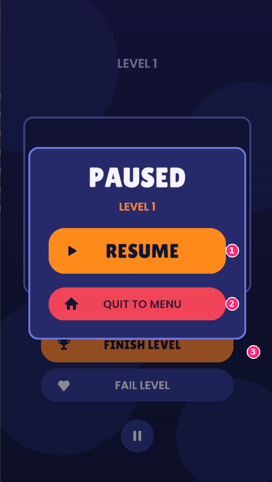 | 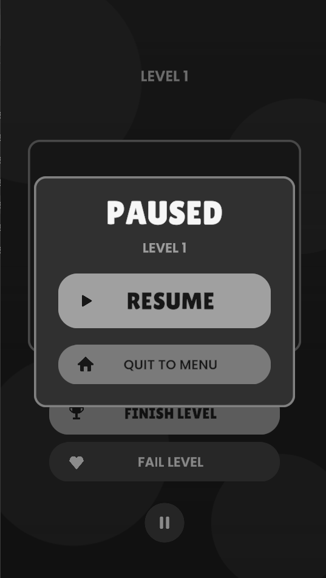 |

1. Resume: orange, the main action.
2. Quit: red, with a different icon.
3. Dimmed game behind the panel.

**Greyscale check:** Resume and Quit are different greys and each has its own label.

### 7. Results

**Purpose:** Shows the result of the level and what to do next. The first screenshot is a win, the second a fail.

**Principles:** The banner colour, the trophy and the title text all say win or fail, so colour is not the only signal. Stars and Next Level only appear after a win.

**Tweens / ease:** Pops in (grows from 85% with a small overshoot, `popCurve`) because it opens on top of the game instead of beside it.

| Colour (annotated) | Greyscale |
|---|---|
| 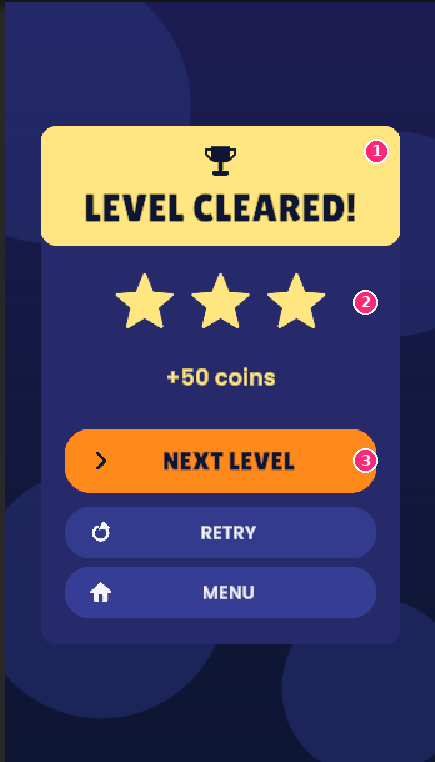 | 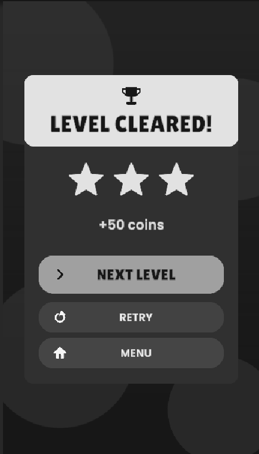 |
| 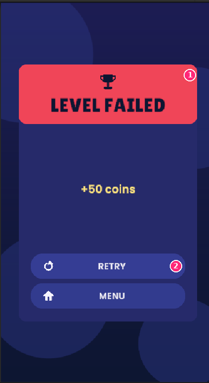 | 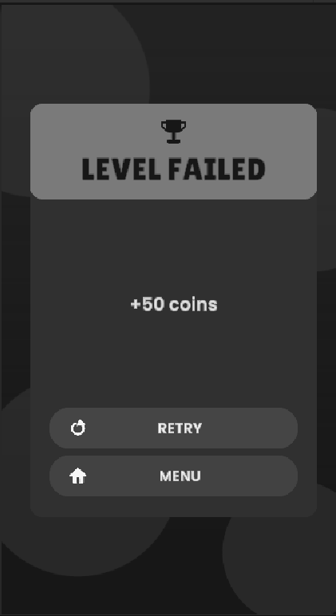 |

1. Banner: gold for a win, red for a fail.
2. Stars (win only).
3. NEXT LEVEL: the main action, orange.

Fail screenshot: (1) red banner, (2) RETRY is the main action here, because there is no Next Level after a fail.

**Greyscale check:** The win banner is light grey and the fail banner mid-grey, and the title text says which one it is.

### 8. Shop

**Purpose:** Spend coins on three boosts.

**Principles:** Same row for every item. The coin balance is always visible. After buying, the button text changes to OWNED.

**Tweens / ease:** Slides in from the right with the ease-in-out curve (`slideCurve`) while fading in.

| Colour (annotated) | Greyscale |
|---|---|
| 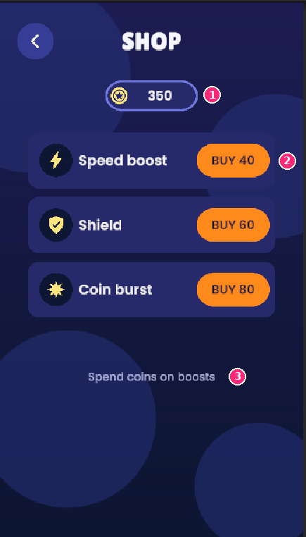 | 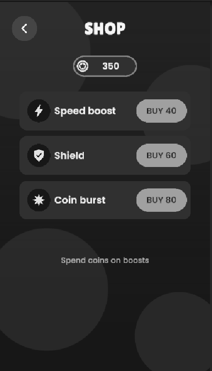 |

1. Coin balance (shared with the Main Menu).
2. BUY button with the price written on it.
3. Message line: says what happened (bought, or not enough coins).

**Greyscale check:** BUY buttons keep the word and price, so they read the same in grey.

### 9. Settings

**Purpose:** Vibration, tips and brightness.

**Principles:** Same row pattern for every setting (icon + label left, control right). Switches are tick boxes with a check mark, so on/off is not only colour. The slider handle is large.

**Tweens / ease:** Slides in from the right with the ease-in-out curve (`slideCurve`) while fading in.

| Colour (annotated) | Greyscale |
|---|---|
| 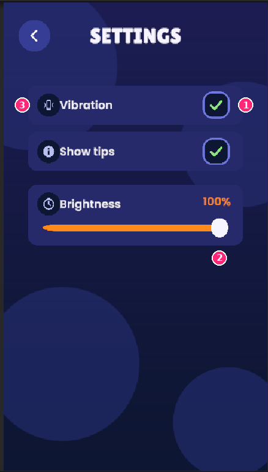 | 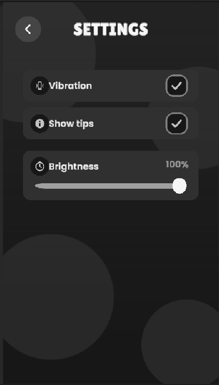 |

1. Tick box: the check mark shows on/off.
2. Brightness slider with a big handle.
3. Every row follows the same layout.

**Greyscale check:** The check mark is still clear in grey, so the switches work without colour.

### 10. Credits

**Purpose:** Who made the game and what was used.

**Principles:** Typographic hierarchy: small coloured headings and white names, centred, with one back button.

**Tweens / ease:** Slides in from the right with the ease-in-out curve (`slideCurve`) while fading in.

| Colour (annotated) | Greyscale |
|---|---|
| 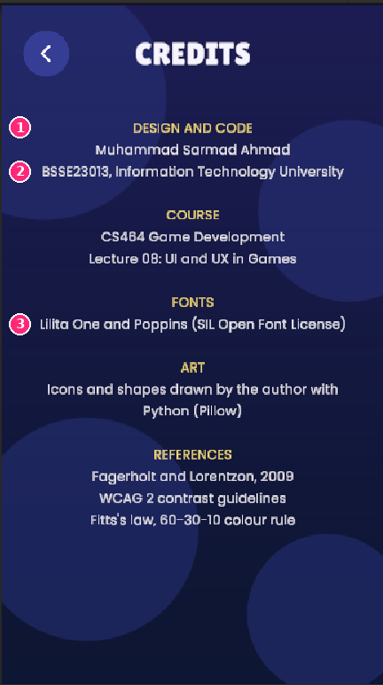 | 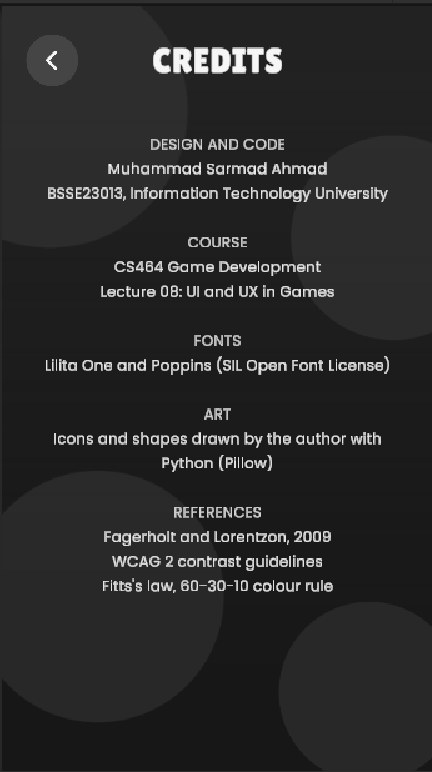 |

1. Section heading in gold.
2. Name and roll number.
3. Fonts and art credits.

**Greyscale check:** Headings and names end up almost the same grey, so the headings are separated by size, capital letters and spacing, not only by their gold colour.

## Code

Six small scripts in `Assets/Lab07/Scripts`:

- `UIManager`: shows one screen at a time and plays the slide / pop tweens. Every button calls one of its public methods from the Button's OnClick list.
- `Shop`: coins and the three Buy buttons.
- `SkinPicker`: changes the preview and moves the selection frame.
- `SettingsMenu`: vibration, tips and brightness.
- `ButtonPress`: the 94% press feedback.
- `Pulse`: the pulsing text on the Title screen.
